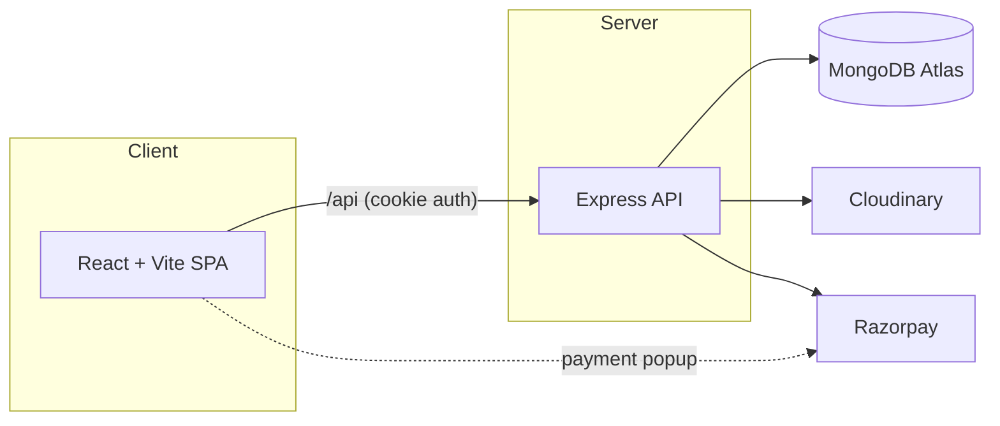
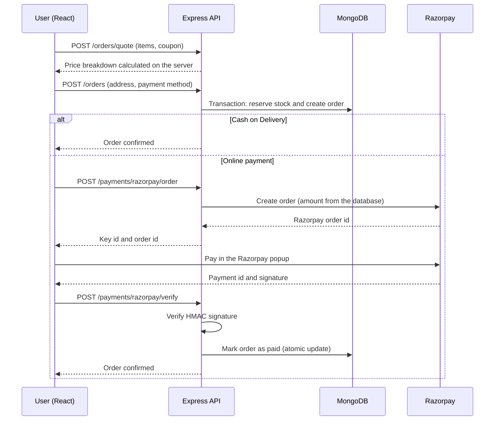
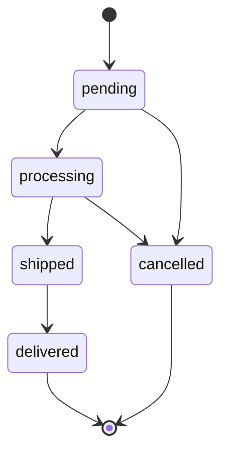

# Shopora

A full-stack fashion and lifestyle e-commerce platform built for the Indian market. Customers can browse collections, build a bag and wishlist, save delivery addresses, and pay with **Cash on Delivery** or **Razorpay**. Store owners get an **admin dashboard** to manage products (with image uploads, trash and restore) and orders.


---

## Table of contents

- [Highlights](#highlights)
- [Features](#features)
- [Tech stack](#tech-stack)
- [Architecture](#architecture)
- [Key engineering decisions](#key-engineering-decisions)
- [Checkout and order flow](#checkout-and-order-flow)
- [Project structure](#project-structure)
- [Getting started](#getting-started)
- [Environment variables](#environment-variables)
- [Available scripts](#available-scripts)
- [API reference](#api-reference)
- [Data models](#data-models)
- [Security](#security)
- [Known limitations and roadmap](#known-limitations-and-roadmap)
- [Author](#author)

---

## Highlights

If you only have two minutes, these are the parts of the project I am most proud of:

- **The server is the source of truth for money.** Prices, coupons, delivery and platform fees are always recalculated on the backend from the database. The browser only sends product ids and quantities, so a tampered request cannot change what is charged.
- **No overselling.** Stock is reserved inside a MongoDB transaction using conditional atomic updates, so two customers cannot buy the last item at the same time.
- **Secure online payments.** Razorpay payments are confirmed only after the backend verifies the HMAC signature (timing-safe comparison). Unpaid online orders expire after 30 minutes and their stock is released.
- **Soft delete with a Trash.** Deleting a product moves it to Trash. It can be restored, and permanent deletion is only possible from Trash.
- **Clean, feature-based architecture** on both the frontend and the backend, with end-to-end validation using Zod.

---

## Features

### Storefront (customers)

- Browse collections and product pages, filter by category, and load more products with pagination
- Wishlist and shopping bag (select items, change size and quantity, move to wishlist, apply coupon)
- Sign up and log in from a modal, with a session that survives page refresh
- **Login-gated checkout** with three steps: Bag, Address, Payment
- Address book: add, edit, delete, set a default address (up to 10 addresses)
- Payment with **Cash on Delivery** or **online payment (Razorpay: UPI, cards, netbanking)**
- Order confirmation page, **My orders** list, and an order detail page with a progress tracker
- Cancel an order while it is still pending and unpaid
- Product images served from Cloudinary with automatic format and quality optimization
- Loading skeletons, error states with retry, and a responsive layout

### Admin dashboard (`/admin`)

- Protected by a login form and a role check (customers see "Access denied")
- **Products:** paginated table, add and edit form, multi-image upload with preview and client-side compression, per-size stock
- **Trash:** delete moves a product to Trash, with Restore and "Delete forever" (permanent delete only from Trash)
- **Orders:** filter by status, expand an order to see items and address, move it through the allowed statuses
- Cancelling an order puts its stock back automatically

---

## Tech stack

| Layer | Technologies |
| --- | --- |
| Frontend | React 19, TypeScript, Vite, Tailwind CSS v4, React Router v7, Motion (animations), lucide-react, oxlint |
| Backend | Node.js, Express 5, TypeScript (run with `tsx`), Mongoose |
| Database | MongoDB Atlas (replica set, transactions enabled) |
| Auth | JWT (HS256) in a cookie, `bcryptjs` password hashing, role-based access (`customer`, `admin`) |
| Validation | Zod (request bodies and query strings) |
| Images | Multer (memory storage) and Cloudinary |
| Payments | Razorpay (test mode supported) and Cash on Delivery |
| Security | Helmet, CORS restricted to the client origin, rate limiting on auth routes |

---

## Architecture



- The frontend and backend live in one repository (`frontend/` and `backend/`).
- In development, Vite proxies `/api` requests to the Express server, so the browser sees a single origin and cookies work without extra setup.
- The backend follows a **feature-based layout** (`auth`, `products`, `orders`, `payments`, ...). Each feature owns its model, schema, service, controller and routes.
- Controllers stay thin. Business rules (pricing, stock, payment checks) live in services.
- One central error handler turns Zod errors, Multer errors, duplicate keys, invalid ids and custom `AppError`s into consistent JSON responses.

---

## Key engineering decisions

### 1. Server-side pricing

The checkout never trusts prices from the browser. `POST /api/orders/quote` returns the exact breakdown (items, subtotal, coupon, delivery, platform fee, total) calculated from the database, and `POST /api/orders` recalculates everything again before saving. All pricing rules live in one file (`order.pricing.ts`).

| Rule | Value |
| --- | --- |
| Coupon `SHOPORA10` | 10% off, up to ₹300, on orders of ₹999 or more |
| Delivery | ₹49, free when the subtotal is ₹999 or more |
| Platform fee | ₹23 per order |

### 2. Preventing overselling

Placing an order runs inside a MongoDB transaction. For every line item the stock is decremented with a conditional update (`stock >= quantity`). If any item cannot be reserved, the whole transaction rolls back and nothing is saved. Products with sizes keep stock per size.

### 3. Safe online payments

- The Razorpay order amount comes from the saved order, never from the client.
- After payment, the backend verifies `HMAC_SHA256(razorpay_order_id|razorpay_payment_id)` with a timing-safe comparison before marking the order as paid.
- Verification is idempotent, and the "mark as paid" step is an atomic update that only succeeds for orders that are still pending.
- Unpaid online orders hold stock, so they expire after 30 minutes. Stock is restored and the payment is marked as failed.
- If the user closes the payment popup, retrying the payment reuses the same order instead of creating duplicates.

### 4. Soft delete and Trash

Products are never deleted directly. A `deletedAt` timestamp hides them from the store, from collection counts and from new orders (the filter lives in one shared query builder). Permanent deletion is rejected unless the product is already in Trash. Soft delete also keeps product data available for order history.

### 5. Composable auth middleware

`requireAuth` and `requireAdmin` are middleware chains that attach the user and then check login and role. Routes opt in with one line, and a whole admin router is protected with a single `use()` call.

### 6. Image pipeline

The admin form compresses large photos in the browser (max 1600px, WebP), sends them to the API as multipart data, Multer keeps them in memory, and the backend streams them to Cloudinary. The database stores the Cloudinary URL. The storefront requests resized versions (`f_auto,q_auto,w_900`) so pages stay fast.

### 7. Resilient frontend state

- The bag and wishlist are stored in `localStorage` as product uids. A small product cache lets them show API products after a refresh. Older local items are matched by SKU, so nothing in an existing bag breaks.
- The checkout draft (selected items and coupon) lives in `sessionStorage`, so a refresh does not lose the checkout.
- Data-fetching effects use an `ignore` flag to avoid state updates from stale responses (no race conditions when filters change quickly).

### 8. Idempotent seed scripts

`seed:catalog` and `seed:images` can be run repeatedly. Products are matched by SKU, existing records are skipped, and `--reset` / `--force` flags are available when a clean start is needed.

---

## Checkout and order flow



### Order status lifecycle



- Customers can cancel only while an order is **pending and unpaid**.
- Admins can move an order forward, or cancel it until it ships. Invalid jumps (for example `pending` to `delivered`) are rejected by the API.
- Cancelling restores the stock. When a **Cash on Delivery** order is marked delivered, its payment is marked as paid.
- Paid online orders are not refunded automatically. Refunds are done from the Razorpay dashboard.

---

## Project structure

```
shopora-ecommerce/
├── backend/
│   └── src/
│       ├── app.ts                 # Express app setup (middleware and routes)
│       ├── server.ts              # Boots the DB connection and the HTTP server
│       ├── config/                # env validation (Zod), database, Cloudinary
│       ├── features/
│       │   ├── auth/              # register, login, logout, me, auth middleware
│       │   ├── users/             # user model and service
│       │   ├── products/          # products, collections, admin catalog, trash
│       │   ├── addresses/         # saved delivery addresses
│       │   ├── orders/            # quote, create order, cancel, admin status, pricing
│       │   ├── payments/          # Razorpay order creation and verification
│       │   ├── uploads/           # image upload to Cloudinary
│       │   └── health/            # health check
│       ├── scripts/               # seedCatalog.ts, seedImages.ts, seed data
│       └── shared/                # AppError, error handler, validation, async handler
└── frontend/
    └── src/
        ├── app/                   # App routes, site layout, global panels
        ├── features/
        │   ├── admin/             # admin guard, layout, products table and form
        │   ├── addresses/         # address form, cards, hooks
        │   ├── auth/              # login and sign-up modal
        │   ├── cart/              # bag view and price details
        │   ├── checkout/          # stepper, address step, payment step, quote
        │   ├── orders/            # order types, status badge, helpers
        │   ├── products/          # product card and detail, collection hook, API
        │   ├── home/  navbar/  footer/  search/  wishlist/
        ├── pages/                 # route-level pages
        └── shared/                # api client, store providers, hooks, utils, panels
```

---

## Getting started

### Prerequisites

- **Node.js 20 or newer** and npm
- A **MongoDB Atlas** cluster (free M0 works). Transactions need a replica set, which Atlas provides. Add your IP address under **Network Access**.
- A free **Cloudinary** account (for product images)
- Optional: a **Razorpay** account in **Test Mode** (for online payments)

### 1. Clone and install

```bash
git clone <your-repository-url>
cd shopora-ecommerce

cd backend && npm install
cd ../frontend && npm install
```

### 2. Configure the backend

Create `backend/.env` (see [Environment variables](#environment-variables)):

```env
NODE_ENV=development
PORT=5000
CLIENT_URL=http://localhost:5173

MONGODB_URI=mongodb+srv://<user>:<password>@<cluster>.mongodb.net/shopora
JWT_SECRET=replace-with-a-random-string-of-at-least-32-characters

CLOUDINARY_CLOUD_NAME=your_cloud_name
CLOUDINARY_API_KEY=your_api_key
CLOUDINARY_API_SECRET=your_api_secret

# Optional, only needed for online payments
RAZORPAY_KEY_ID=rzp_test_xxxxxxxxxxxx
RAZORPAY_KEY_SECRET=your_test_key_secret
```

Never commit `.env`. It contains secrets.

### 3. Seed the catalog

From the `backend` folder:

```bash
npm run seed:catalog     creates 16 collections and 104 products
npm run seed:images      uploads the product and banner images to Cloudinary
```

`seed:images` reads the images from `frontend/src/features/products/assets` and saves the Cloudinary URLs on each product. Use `npm run seed:catalog -- --reset` to wipe and re-seed the catalog.

### 4. Run the app

Use two terminals:

```bash
Terminal 1: API on http://localhost:5000
cd backend
npm run dev

Terminal 2: web app on http://localhost:5173
cd frontend
npm run dev
```

Open `http://localhost:5173`.

### 5. Create an admin account

1. Sign up as a normal user from the storefront.
2. In MongoDB Atlas, open the `users` collection and change that user's `role` from `"customer"` to `"admin"`.
3. Open `http://localhost:5173/admin` and log in.

### 6. Try the checkout

- **Coupon:** `SHOPORA10` (needs a subtotal of ₹999 or more)
- **Cash on Delivery:** works with no setup
- **Razorpay test mode:** card `4111 1111 1111 1111` with any future expiry and any CVV, or UPI id `success@razorpay` (use `failure@razorpay` to test a failed payment)

---

## Environment variables

### Backend (`backend/.env`)

| Variable | Required | Description |
| --- | --- | --- |
| `NODE_ENV` | No | `development` (default), `production` or `test` |
| `PORT` | No | API port, default `5000` |
| `CLIENT_URL` | No | Allowed CORS origin, default `http://localhost:5173` |
| `MONGODB_URI` | Yes | MongoDB Atlas connection string |
| `JWT_SECRET` | Yes | Secret used to sign tokens, at least 32 characters |
| `CLOUDINARY_CLOUD_NAME` | Yes | Cloudinary cloud name |
| `CLOUDINARY_API_KEY` | Yes | Cloudinary API key |
| `CLOUDINARY_API_SECRET` | Yes | Cloudinary API secret |
| `RAZORPAY_KEY_ID` | No | Enables online payment when set together with the secret |
| `RAZORPAY_KEY_SECRET` | No | Razorpay key secret (backend only, never exposed to the browser) |
| `ADMIN_NAME`, `ADMIN_EMAIL`, `ADMIN_PHONE`, `ADMIN_PASSWORD` | No | Optional values for an admin account |

The environment is validated with Zod at startup. The server refuses to start if a required value is missing or invalid.

### Frontend (`frontend/.env`, optional)

| Variable | Description |
| --- | --- |
| `VITE_API_URL` | API base URL. Defaults to `/api`, which the Vite dev server proxies to the backend. |

---

## Available scripts

### Backend

| Command | What it does |
| --- | --- |
| `npm run dev` | Starts the API with hot reload (`tsx watch`) |
| `npm run seed:catalog` | Seeds collections and products (add `-- --reset` to start clean) |
| `npm run seed:images` | Uploads local product images to Cloudinary (add `-- --force` to re-upload) |

### Frontend

| Command | What it does |
| --- | --- |
| `npm run dev` | Starts the Vite dev server |
| `npm run build` | Type-checks (`tsc -b`) and builds for production |
| `npm run preview` | Serves the production build locally |
| `npm run lint` | Lints the code with oxlint |

---

## API reference

All routes are prefixed with `/api`. Errors use the shape `{ "message": "...", "details": [...] }`, and validation errors list the failing `field` and `message`. Authentication uses a cookie, so requests from the browser must send credentials.

### Auth

| Method | Route | Access | Description |
| --- | --- | --- | --- |
| POST | `/auth/register` | Public | Create an account |
| POST | `/auth/login` | Public | Log in |
| POST | `/auth/logout` | Public | Log out |
| GET | `/auth/me` | Public | Current user or `null` |

### Catalog

| Method | Route | Access | Description |
| --- | --- | --- | --- |
| GET | `/collections` | Public | All collections with product counts |
| GET | `/collections/:slug` | Public | A collection with its products and available filters |
| GET | `/products` | Public | Product list. Query: `collection`, `category`, `tag`, `search`, `minPrice`, `maxPrice`, `sort` (`newest`, `price_asc`, `price_desc`, `popular`), `page`, `limit` |
| GET | `/products/:id` | Public | Single product |

### Admin: products and uploads

| Method | Route | Access | Description |
| --- | --- | --- | --- |
| GET | `/admin/products` | Admin | List products. Extra query: `status` (`all`, `active`, `inactive`, `trash`) |
| GET | `/admin/products/:id` | Admin | Single product |
| POST | `/admin/products` | Admin | Create a product |
| PUT | `/admin/products/:id` | Admin | Update a product |
| PATCH | `/admin/products/:id/status` | Admin | Activate or deactivate |
| DELETE | `/admin/products/:id` | Admin | Move to Trash |
| POST | `/admin/products/:id/restore` | Admin | Restore from Trash |
| DELETE | `/admin/products/:id/permanent` | Admin | Delete forever (only if already in Trash) |
| POST | `/admin/uploads` | Admin | Upload up to 5 images (`images` field) to Cloudinary |

### Addresses

| Method | Route | Access | Description |
| --- | --- | --- | --- |
| GET | `/addresses` | User | List saved addresses (default first) |
| POST | `/addresses` | User | Add an address |
| PUT | `/addresses/:id` | User | Update an address |
| PATCH | `/addresses/:id/default` | User | Set as the default address |
| DELETE | `/addresses/:id` | User | Delete an address |

### Orders

| Method | Route | Access | Description |
| --- | --- | --- | --- |
| POST | `/orders/quote` | User | Price breakdown calculated on the server, with stock checks |
| POST | `/orders` | User | Place an order (Cash on Delivery or Razorpay) |
| GET | `/orders/my-orders` | User | My orders |
| GET | `/orders/my-orders/:id` | User | One of my orders |
| POST | `/orders/my-orders/:id/cancel` | User | Cancel a pending, unpaid order |
| GET | `/orders` | Admin | All orders. Query: `status`, `page`, `limit` |
| PATCH | `/orders/:id/status` | Admin | Update status (only valid transitions are allowed) |

### Payments

| Method | Route | Access | Description |
| --- | --- | --- | --- |
| POST | `/payments/razorpay/order` | User | Create a Razorpay order for an existing pending order |
| POST | `/payments/razorpay/verify` | User | Verify the payment signature and mark the order as paid |

### Other

| Method | Route | Description |
| --- | --- | --- |
| GET | `/health` | Health check |

---

## Data models

| Model | Main fields |
| --- | --- |
| **User** | `name`, `email` (unique), `phone`, `passwordHash`, `role` |
| **Product** | `sku` (unique), `title`, `brand`, `description`, `price`, `originalPrice`, `category`, `collectionSlug`, `images[]`, `sizes[{ label, stock }]`, `stock`, `tag`, `rating`, `reviewsCount`, `isActive`, `deletedAt` |
| **Collection** | `slug`, `title`, `description`, `banner`, `isVirtual`, `sortOrder`, `isActive` |
| **Address** | `user`, `label`, `fullName`, `phone`, `addressLine1`, `addressLine2`, `city`, `state`, `pincode`, `isDefault` |
| **Order** | `orderNumber`, `user`, `items[]` (price snapshot), `shippingAddress` (snapshot), `subtotal`, `shippingFee`, `platformFee`, `couponCode`, `couponDiscount`, `total`, `status`, `paymentMethod`, `paymentStatus`, `razorpayOrderId`, `razorpayPaymentId`, `paidAt` |

Orders store a **snapshot** of the item prices, titles, images and the delivery address, so past orders stay correct even if a product or address changes later.

Some collections (`new`, `bestsellers`, `accessories`) are **virtual**. They are not stored with products. They are computed from product tags and categories.

---

## Security

- Passwords are hashed with bcrypt. Password hashes are never returned by the API.
- Authentication is a signed JWT (HS256) sent in a cookie. Admin routes are protected by role-based middleware.
- Request bodies and query strings are validated with Zod. Unknown fields are stripped.
- Prices, totals and stock are never taken from the client.
- Razorpay secrets stay on the server, and payment signatures are verified before an order is marked as paid.
- Helmet sets secure HTTP headers, CORS only allows the configured client origin, and auth routes are rate limited.
- File uploads accept only image types, with a 5 MB limit per file and at most 5 files per request.
- Secrets live in environment variables and are validated at startup.

---

## Known limitations and roadmap

These are honest gaps I know about, and the order I would tackle them in:

- [ ] **Razorpay webhook** (`payment.captured`). Today, if a customer pays and closes the tab before the confirmation call, the order stays unpaid until it expires. A webhook would confirm it reliably.
- [ ] **Server-synced bag and wishlist.** They live in the browser (`localStorage`) for now, so they do not follow the user across devices.
- [ ] **Home page content from the API.** The home page sections still use local data.
- [ ] **Product page sizes and stock from the API,** so the sizes shown always match what the admin configured.
- [ ] **Delete product images from Cloudinary** when a product is permanently deleted.
- [ ] **Automated refunds** for cancelled paid orders.
- [ ] **Email notifications** for order confirmation and status changes.
- [ ] **Automated tests:** unit tests for pricing, integration tests for checkout and stock handling.
- [ ] **CI and deployment** (frontend and API on a hosting platform) with a live demo link.
- [ ] Product reviews and ratings submitted by customers, and downloadable invoices.

---

## Author

**[Your Name]**

- GitHub: [github.com/your-username](https://github.com/rohil1418)
- LinkedIn: [linkedin.com/in/your-profile](https://www.linkedin.com/in/rohilkhan)
- Email: rohilkhan071@gmail.com
